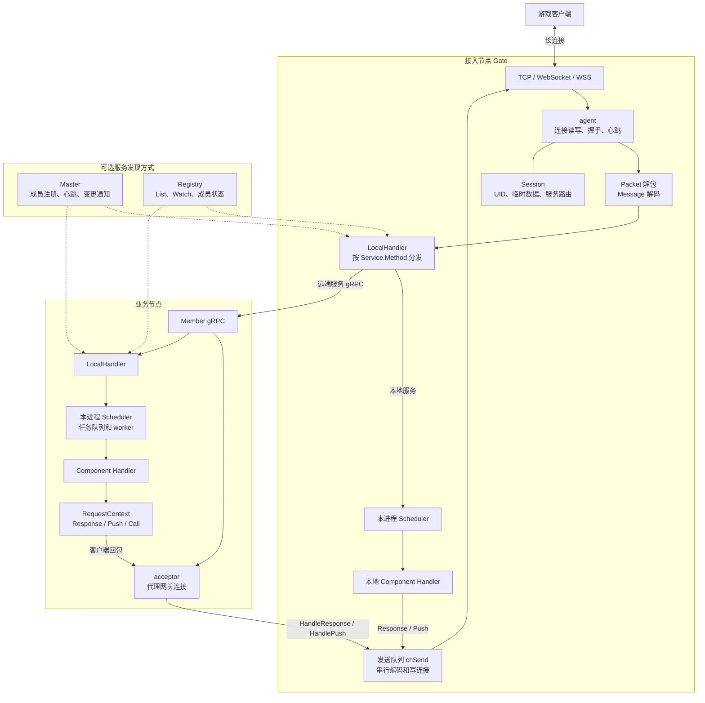
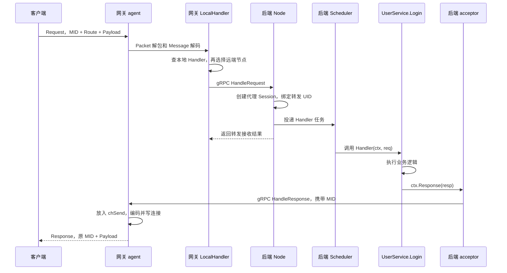

# Nano 框架架构与核心实现

整理日期为 2026-11-17。本文基于当前工作区 `nano` 源码，并结合相邻 `gameServer` 的接入方式说明实际使用场景。

## 一、整体定位

Nano 提供游戏服务器的长连接接入、协议编解码、组件化消息分发、请求上下文、任务调度和跨节点调用能力。

当前代码支持单机、Master 集群和 Registry 集群。应用通过注册 Component 暴露业务 Handler，通过 `RequestContext` 完成响应、推送和内部调用。

`nano-contrib` 是独立模块，提供 etcd、OpenTelemetry 和 Prometheus 的具体适配。`gameServer` 负责用户、钱包、匹配、游戏、牌桌归属和连接目录等业务实现。

## 二、整体架构图



Gate 和 Backend 都由 `cluster.Node` 承载。一个节点可以同时接入客户端、挂载业务组件和调用其他节点。各进程拥有自己的 Scheduler 和 Session 表。

主要实现见 [cluster/node.go](../cluster/node.go) 和 [cluster/handler.go](../cluster/handler.go)。

## 三、模块与目录职责

| 模块 | 核心职责 |
|---|---|
| `interface.go`、`options.go` | `nano.Listen` 入口、配置组装、信号退出 |
| `cluster/node.go` | 节点生命周期、客户端监听、集群 gRPC 接口、Session 表 |
| `cluster/handler.go` | 组件注册、本地分发、远程路由、内部调用、错误兜底 |
| `cluster/agent.go` | 客户端真实连接、发送队列、心跳、写超时、关闭 |
| `cluster/acceptor.go` | 后端连接代理，通过 gRPC 回到网关 |
| `cluster/connpool.go` | 按远端地址缓存 gRPC 连接池，轮询选取连接 |
| `cluster/registry_discovery.go` | 将注册中心快照和事件转换为成员及路由视图 |
| `component` | 反射提取 Handler，生成 `Service.Method` 路由 |
| `session` | 连接级状态、用户绑定、请求级上下文、服务路由绑定 |
| `scheduler` | 全局任务池、定时器、连接关闭回调调度 |
| `internal/codec` | 外层 Packet 编解码、粘包与半包处理 |
| `internal/message` | 内层消息类型、MID、路由、系统错误码 |
| `serialize` | protobuf、JSON 业务载荷序列化 |
| `pipeline` | 入站和出站消息处理链 |
| `registry` | 注册中心契约、租约接口、成员状态、发现视图和运行时 |
| `service` | Session ID 生成、连接数及认证用户统计 |
| `group.go` | Session 分组、广播、组播 |

## 四、启动与退出流程

```text
nano.Listen(addr, options...)
    ↓
应用 Option，组装 cluster.Options
    ↓
创建 cluster.Node
    ↓
Node.Startup()
    ├─ 创建 Session 表、cluster 和 LocalHandler
    ├─ 反射注册 Components
    ├─ 缓存握手响应与心跳包
    ├─ 初始化集群与服务发现
    ├─ 依次执行所有组件 Init()
    ├─ 依次执行所有组件 AfterInit()
    └─ 启动客户端 TCP / WS 监听
    ↓
启动全局 Scheduler
    ↓
等待退出信号
    ↓
Node.Shutdown() → scheduler.Close()
```

退出时，组件的 `BeforeShutdown()` 和 `Shutdown()` 按注册顺序的逆序执行，随后停止发现订阅、监听服务和 RPC 连接池。

框架有较多进程级全局状态，包括 Serializer、Scheduler、路由字典和退出通道，整体使用模型偏向一个进程运行一个 Nano 应用。

入口见 [interface.go](../interface.go)，节点生命周期见 [cluster/node.go](../cluster/node.go)。

### 三种运行方式

| 方式 | 主要配置 | 运行逻辑 |
|---|---|---|
| 单机 | 未开启 Master，未配置发现后端 | 客户端直接调用本地组件 |
| Master 集群 | `WithMaster`、`WithAdvertiseAddr` | Master 管理成员，节点之间直接通信 |
| Registry 集群 | `WithRegistry` | 节点通过 `List + Watch` 更新成员和服务路由 |

`WithAdvertiseAddr` 在普通成员上指定 Master 地址。`WithMemberAddr` 指定当前节点向其他成员公布的地址。`WithClientAddr` 指定客户端接入地址。

当前源码已经支持 Registry 直接驱动服务发现和实际路由。现有 `docs/service_governance_zh_CN.md` 及架构 Review 中关于“etcd 尚未替代 master，仍必须启动 master”的描述已经落后于实现。配置 `WithRegistry` 后，普通节点会进入注册中心发现分支。

`WithRegistry` 为 Node 提供发现后端。本节点注册与租约生命周期由应用调用 `registry.StartRuntime()` 接入，`gameServer/cmd/runtime.go` 中包含这一流程。

实现见 [cluster/node.go](../cluster/node.go)、[cluster/registry_discovery.go](../cluster/registry_discovery.go) 和 [registry/runtime.go](../registry/runtime.go)。

## 五、客户端请求的完整执行链路

以下以客户端请求远端 `UserService.Login` 为例。



Handler 任务与转发 RPC 返回可并发推进。图中按先返回转发结果、再执行任务展示一条可能的时序。

### 1. 建立连接与握手

每条客户端连接建立一个 `agent` 和一个 `Session`，启动读循环与写循环。

连接状态依次经过 `Start → Handshake → Working → Closed`。客户端发送 Handshake，服务端返回心跳间隔、服务时间和可选路由字典，客户端再发送 HandshakeAck，随后进入业务通信阶段。

握手阶段受读取 deadline 约束。进入工作状态后，写循环定期检查最近接收时间并发送心跳，超过约两个心跳间隔未接收数据时关闭连接。

实现见 [cluster/handler.go](../cluster/handler.go) 中的 `handle()`、`processPacket()` 和 [cluster/agent.go](../cluster/agent.go) 中的 `write()`。

### 2. 判断本地与远端服务

`processMessage()` 先查 `localHandlers[route]`。

- 找到本地方法，进入 `localProcess()`。
- 本地方法缺失时，进入 `remoteProcess()` 查找远端服务。
- 远端服务不存在时，Request 收到系统错误。

远程路由优先使用 Session 中已有的服务地址绑定。首次访问时默认随机选择节点并绑定，后续同一连接访问同一 Service 会继续使用该地址。配置自定义路由函数后，首次选择由应用决定。

成员被移出路由视图时，框架清理对应地址的 Session 路由绑定。实现见 [cluster/handler.go](../cluster/handler.go) 中的 `remoteProcess()`、`delMember()` 和 `syncRemoteMembers()`。

### 3. 反序列化与任务投递

`localProcess()` 依次执行以下步骤。

1. 执行 Inbound Pipeline。
2. 将载荷反序列化为 Handler 参数，原始 `[]byte` 参数会复制数据。
3. 创建 `RequestContext` 并启动请求超时控制。
4. 投递全局 Scheduler 或组件指定的 LocalScheduler。
5. 通过反射执行 Handler。
6. 统一处理 panic、返回错误和遗漏响应。

超时计时从创建请求上下文开始，包含调度队列中的等待时间。默认全局队列满时，Request 返回 `CodeServerBusy`，Notify 被丢弃。

### 4. 回包与推送

本地客户端通过 `agent` 发送，远端客户端通过 `acceptor` 调用网关 `HandleResponse` 或 `HandlePush`，最终汇入真实连接的发送队列。

```text
响应或推送进入 agent.chSend
    → 载荷序列化
    → Outbound Pipeline
    → Message 编码
    → Packet 编码
    → 设置写 deadline
    → 写入客户端连接
```

发送队列使用非阻塞入队，队列满会返回错误。`ctx.Response()` 成功表示发送操作已被当前发送链路接受，客户端实际收到数据还取决于后续编码、网络写入和连接状态。

实现见 [cluster/agent.go](../cluster/agent.go) 和 [cluster/acceptor.go](../cluster/acceptor.go)。

## 六、Component、Session 与 RequestContext

### Component 与 Handler 注册

业务方法使用以下签名，第二个参数也可以为 `[]byte`。

```go
func (s *UserService) Login(
    ctx *session.RequestContext,
    req *LoginReq,
) error
```

组件注册时反射提取符合条件的导出方法，默认以组件类型名作为 Service 名，以方法名作为 Handler 名，生成 `UserService.Login`。

```text
localServices["UserService"]       → Service 元信息
localHandlers["UserService.Login"] → 方法、接收者、参数类型
```

组件支持重命名、方法名转换和自定义调度器名称。实现见 [component/service.go](../component/service.go)、[component/method.go](../component/method.go) 和 [component/options.go](../component/options.go)。

### Session 的连接级状态

Session 保存连接生命周期内的状态。

- Session ID。
- 已绑定 UID。
- 临时键值数据。
- Service 到节点地址的路由绑定。
- 连接归属代次 `ConnectionEpoch`。
- 底层 `NetworkEntity`。

UID 首次绑定后，同 UID 重复绑定具有幂等性，绑定其他 UID 会返回 `ErrUIDMismatch`。

网关 Session 的底层对象为 `agent`，后端 Session 的底层对象为 `acceptor`。后端代理使用网关地址和原始 Session ID 将响应送回真实连接。各节点的 Session 临时数据分别存储，跨节点传输请求载荷、身份和回程信息。

实现见 [session/session.go](../session/session.go) 和 [cluster/node.go](../cluster/node.go) 中的 `findOrCreateSession()`。

### RequestContext 的请求级状态

每次请求独立创建 `RequestContext`，保存请求 MID、UID 快照、Context、内部调用能力和响应状态。

同一连接的多个请求即使乱序执行完成，响应仍使用各自捕获的 MID。`Response()` 通过原子状态控制重复回包。Handler 返回时尚未响应，框架发送系统错误。请求超时后也会尝试发送超时响应。

Handler 应在返回前完成 `ctx.Response()`。后台任务可以保存 Session，通过后续 Push 发送结果。`DetachCaller()` 可以保留内部调用能力和 UID，后续调用使用显式传入的 Context 管理生命周期。

实现见 [session/context.go](../session/context.go) 和 [cluster/handler.go](../cluster/handler.go) 中的 `invokeHandler()`。

## 七、跨节点调用与实例选择

| 入口 | 选择方式 | 主要语义 |
|---|---|---|
| `ctx.RPC()` | Session 服务路由 | 以 Notify 形式发送，调用方无业务响应 |
| `ctx.Call()` | 本地优先，远端随机选择 | 同步获取业务响应 |
| `ctx.CallTo()` | 指定 memberID | 同步调用明确实例 |
| `ctx.SelectByKey()` | 按 service、key 和 memberID 计算哈希分数 | 返回稳定选择的实例 ID |

### 内部 Call 链路

```text
ctx.Call(route, req, resp)
    ↓
序列化请求
    ├─ 本地存在 Handler → 直接调用 Node.Call()
    └─ 远端服务 → gRPC Member.Call()
    ↓
Node.Call() 同步执行 Handler
    ↓
ctx.Response() 写入内部响应
    ↓
反序列化到调用方 resp
```

这条路径直接调用 Handler，绕过客户端消息的 Scheduler 和 Inbound Pipeline。内部请求上下文携带 UID 和调用能力，`Session()` 返回空。内部 Handler 应按其实际能力使用上下文。

实现见 [cluster/handler.go](../cluster/handler.go) 中的 `Call()`、`CallTo()` 和 [cluster/node.go](../cluster/node.go) 中的 `Call()`。

### 稳定选点与成员状态

`SelectByKey(service, key)` 根据 `service + key + memberID` 的 SHA-256 哈希分数选择实例，属于 Rendezvous Hashing。相同成员集合下，相同 key 的结果稳定。

| 成员状态 | 新实例选择 | 指定实例调用 |
|---|---|---|
| `active` | 参与 | 允许 |
| `draining` | 排除 | 允许 |
| `retired` | 排除 | 排除 |

存量牌桌可以通过明确的 owner memberID 继续调用 draining 节点。普通服务路由中的 draining 节点会被移除，其 Session 地址绑定也会清理。

`WithLocalMemberID` 让单机部署也能通过实例 ID 选择和调用本地服务。版本化服务别名可以作为路由能力声明，实际 RPC 继续使用 `Service.Method`。

实现见 [cluster/handler.go](../cluster/handler.go) 和 [registry/registry.go](../registry/registry.go)。

### RPC 超时与认证

框架跨节点调用通过 `rpcContext()` 设置 deadline，并在配置 token 后携带集群认证 metadata。服务端先执行框架认证 interceptor，再执行应用注入的 interceptor。

默认请求超时为 5 秒，RPC 超时为 3 秒，连接写超时为 5 秒，可通过对应 Option 配置。token 为空时认证 interceptor 放行。实现见 [cluster/rpc_context.go](../cluster/rpc_context.go) 和 [options.go](../options.go)。

## 八、协议结构

```text
Packet
├─ Type          1 字节
├─ Length        3 字节，大端序
└─ Data
   └─ Message
      ├─ Flag     错误码、消息类型、路由压缩标记
      ├─ MID      Request / Response 携带
      ├─ Route    Request / Notify / Push 携带
      └─ Payload  protobuf / JSON / 原始字节
```

| 消息类型 | MID | Route | 作用 |
|---|---|---|---|
| Request | 携带 | 携带 | 客户端发起请求 |
| Notify | 省略 | 携带 | 单向通知 |
| Response | 携带 | 省略 | 按 MID 关联请求 |
| Push | 省略 | 携带 | 服务端主动推送 |

当前 Packet 数据上限为 64 KiB。MID 使用变长编码，路由可通过字典压缩为 `uint16`。Flag 高四位存储系统错误码，范围为 `0～15`。业务错误通过响应体表达，`ctx.Response()` 使用 `CodeOk` 系统码。

实现见 [internal/codec/codec.go](../internal/codec/codec.go)、[internal/message/message.go](../internal/message/message.go) 和 [pkg/errcode/errcode.go](../pkg/errcode/errcode.go)。

## 九、并发、定时器与连接关闭

| 执行内容 | 所在位置 |
|---|---|
| 连接读取和消息解析 | 每连接读 goroutine |
| 连接发送和心跳 | 每连接写 goroutine |
| 普通客户端 Handler | 全局 worker 池 |
| 自定义调度 Handler | Session 中的 LocalScheduler |
| 内部 Call Handler | 调用 goroutine 或 gRPC goroutine |
| Timer 回调 | 独立的单 goroutine 定时循环 |
| 连接关闭回调 | 按需启动的独立关闭任务 worker |

全局 worker 数默认取 `GOMAXPROCS`，任务队列默认容量为 `256`。`WithScheduler` 可以在启动前配置 worker 数和队列容量。`Stats()` 提供队列长度、提交量、拒绝量、累计排队及执行耗时等快照。

Timer 默认检查精度为一秒，可通过 `WithTimerPrecision` 调整。回调在定时循环中同步执行，支持循环、限定次数、单次和条件定时器。

连接断开时，网关删除本地 Session、释放认证统计，并通知远端节点清理代理 Session。`agent.Close()` 幂等关闭底层连接，通过 `PushCloseTask()` 执行生命周期回调。关闭回调有独立任务队列，业务 Scheduler 停止后仍能处理后续连接关闭任务。

上述执行模型带来以下业务约束。

- 同一 Session 的多个请求可能并发执行，业务完成顺序可能变化。
- 多个玩家访问同一牌桌时，牌桌状态需要业务层提供串行化或同步机制。
- 请求超时会取消 Context 并尝试回包，正在执行的业务代码需要配合 Context 结束。
- 慢 Timer 回调会延迟其他定时任务。
- 网关远端转发在当前连接读链路中同步等待 gRPC 接收结果，受 RPC deadline 约束。

实现见 [scheduler/scheduler.go](../scheduler/scheduler.go)、[scheduler/timer.go](../scheduler/timer.go)、[cluster/handler.go](../cluster/handler.go) 和 [session/lifetime.go](../session/lifetime.go)。

## 十、gameServer 中的实际接入

| gameServer 接入点 | 使用的框架能力 |
|---|---|
| `internal/bootstrap/server.go` | 按角色组装 User、Game、Match、Wallet 等组件 |
| `cmd/gate.go` | WebSocket 接入、`/nano` 路径、Session 回调、自定义路由 |
| `cmd/runtime.go` | Registry 生命周期、成员 ID、发现后端、Trace interceptor |
| `internal/tablerouting` | 牌桌 owner 查询和业务路由 |
| `internal/gateway` | 用户连接目录、跨网关推送和踢人 |

牌桌属于哪个节点由 `gameServer` 的目录和路由逻辑决定。Nano 提供自定义选择函数、`CallTo` 和底层 gRPC 承载。

跨网关定向发送时，Nano 可以校验 UID 与 `ConnectionEpoch`，连接目录负责提供这些定位信息。通过接入 `WithSessionBoundCallback` 和 `WithSessionClosedCallback`，业务工程维护网关连接的外部目录。

业务接入源码见 [bootstrap/server.go](../../gameServer/internal/bootstrap/server.go)、[cmd/gate.go](../../gameServer/cmd/gate.go)、[cmd/runtime.go](../../gameServer/cmd/runtime.go) 和 [gateway/tracker.go](../../gameServer/internal/gateway/tracker.go)。

## 十一、源码阅读顺序与验证范围

按以下顺序阅读可以串起框架主链路。

```text
interface.go
    → cluster/node.go
    → component/service.go
    → cluster/handler.go
    → session/context.go
    → cluster/agent.go 与 acceptor.go
    → scheduler
    → registry
```

本次梳理执行了 `nano` 下的 `go test ./...`，全部通过，其中部分结果命中缓存。本文以当前源码为依据，验证范围覆盖源码和现有测试，实际部署拓扑及多节点运行效果仍需联调确认。
